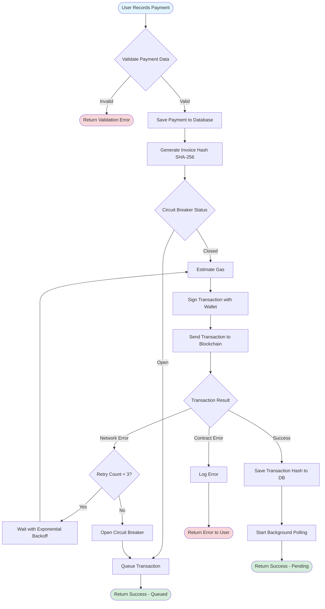
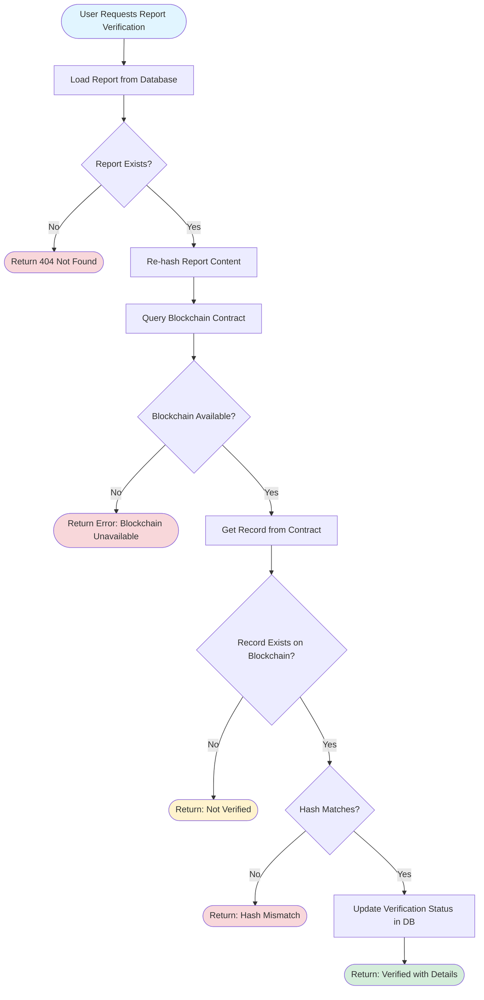
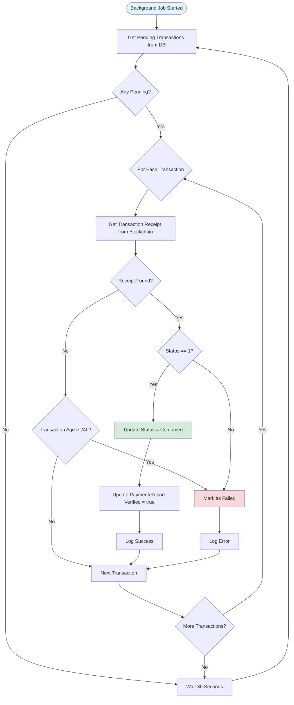
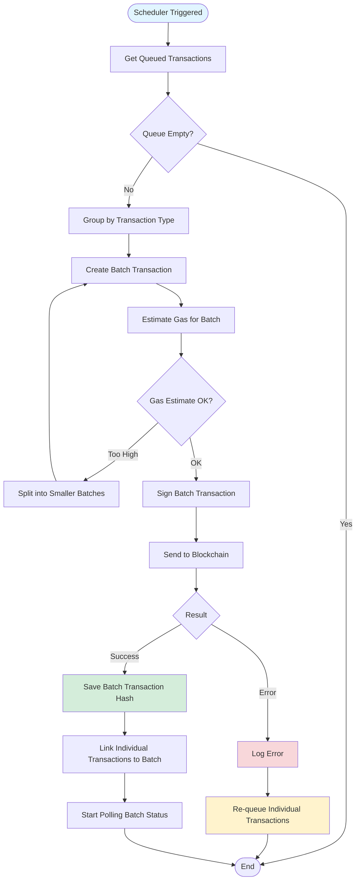
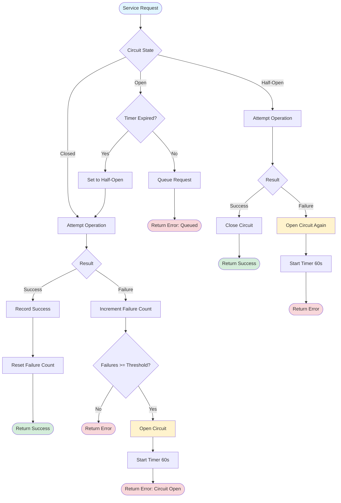
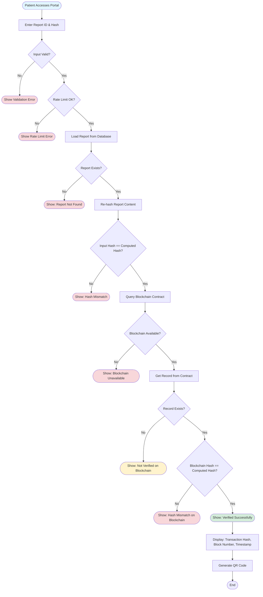

# Blockchain Integration - Flowcharts

## Payment Recording Flowchart

## Report Verification Flowchart

## Transaction Status Polling Flowchart

## Batch Processing Flowchart

## Circuit Breaker State Flowchart

## Public Verification Portal Flowchart

