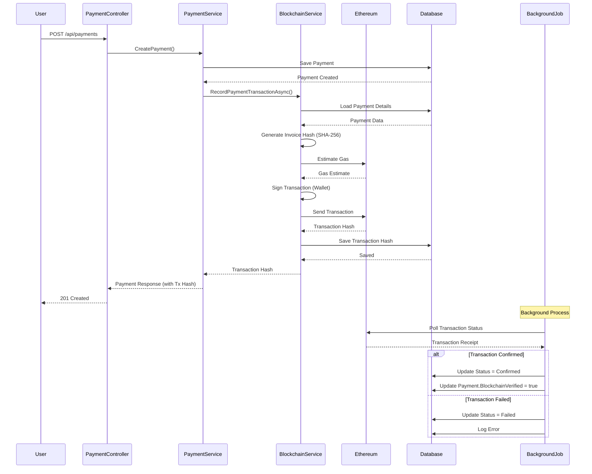
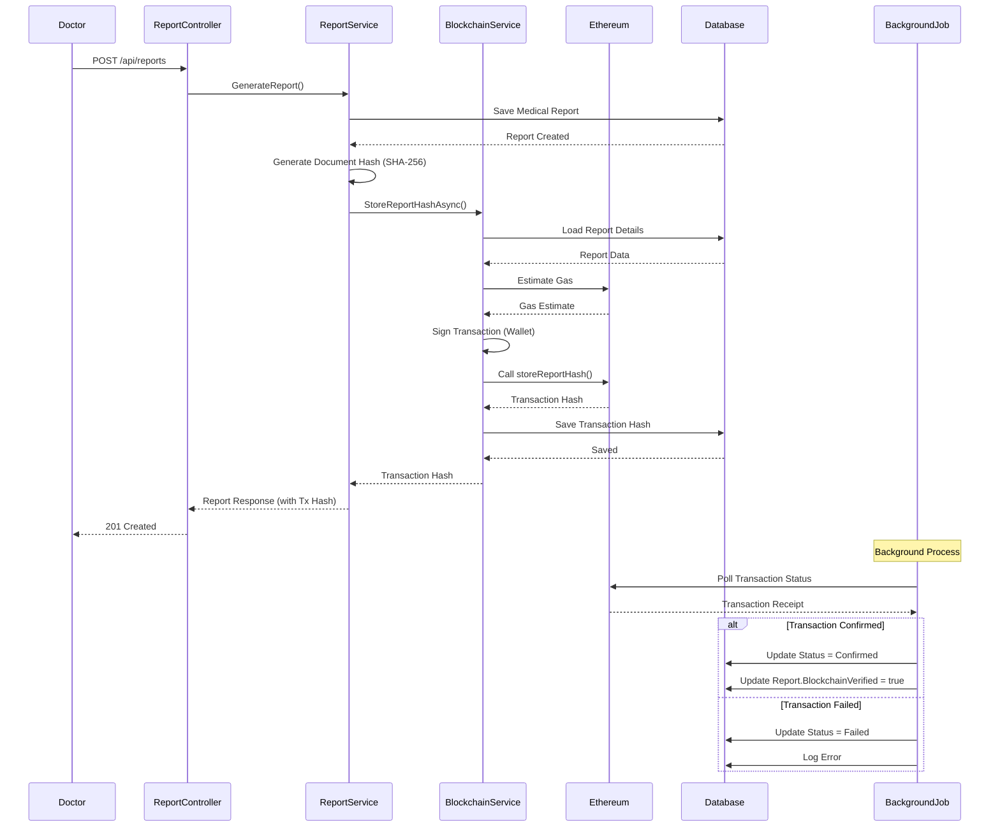
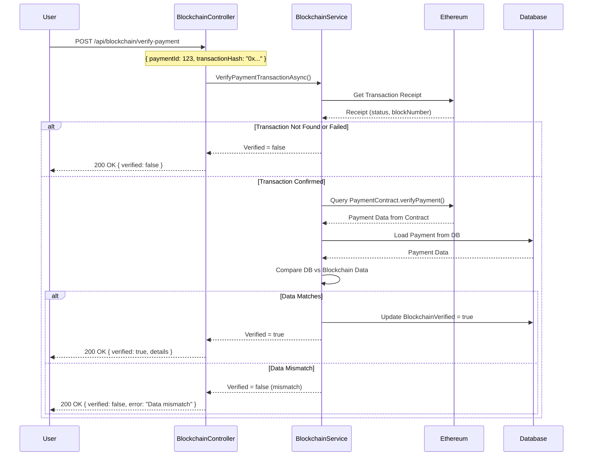
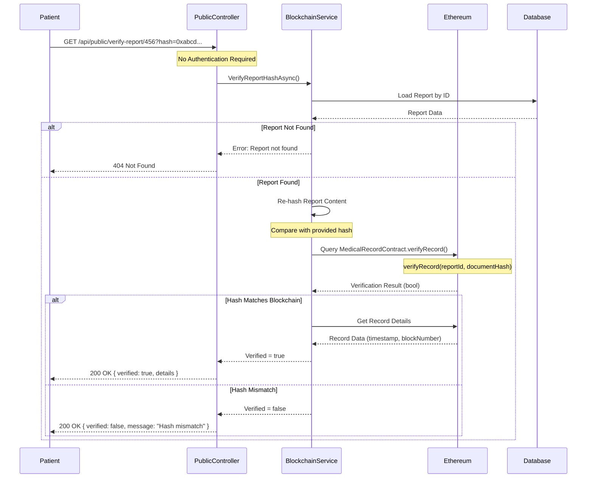
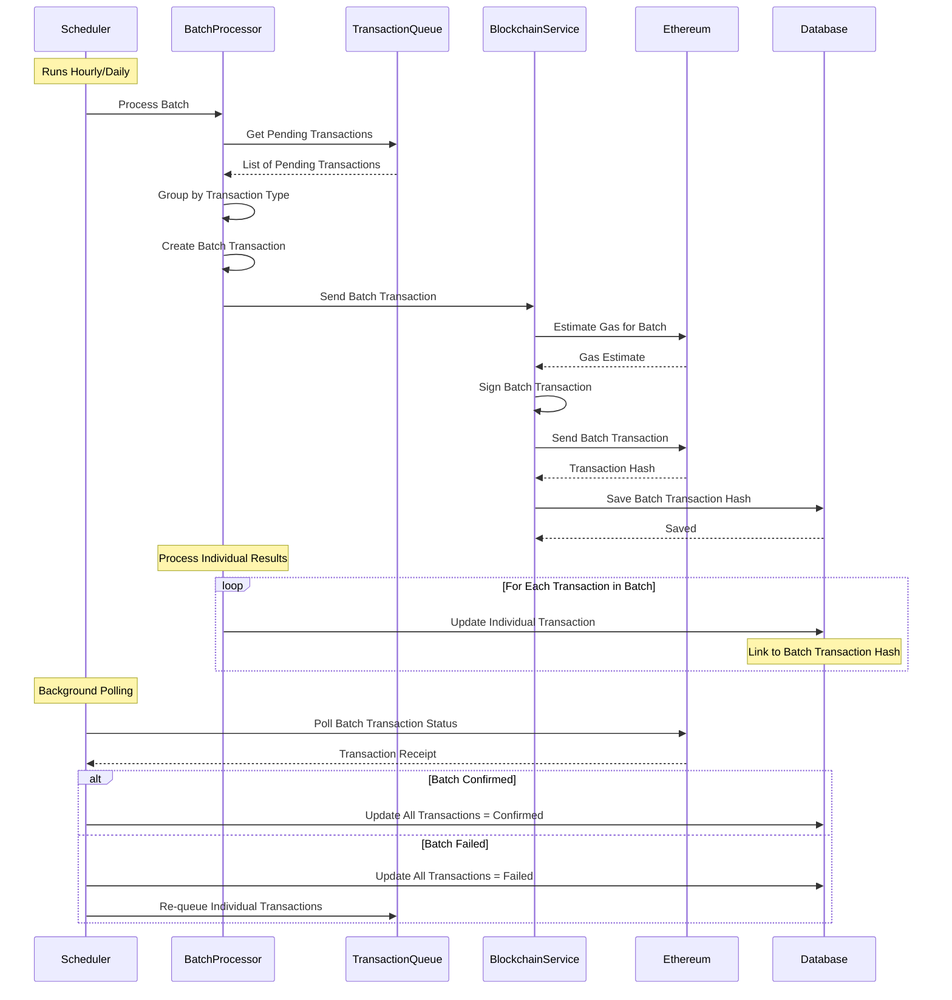
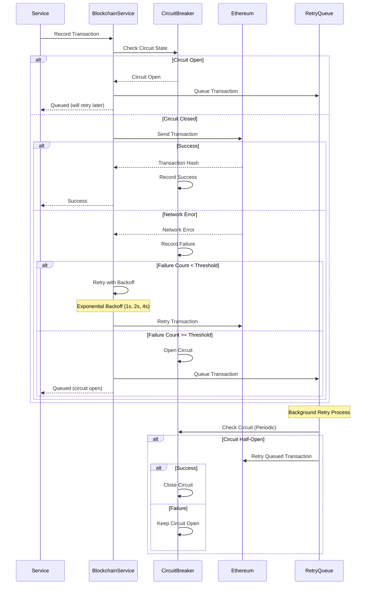

# Blockchain Integration - Sequence Diagrams

## Payment Transaction Recording Sequence

## Medical Report Hash Storage Sequence

## Payment Verification Sequence

## Public Report Verification Sequence

## Batch Transaction Processing Sequence

## Error Handling & Retry Sequence

