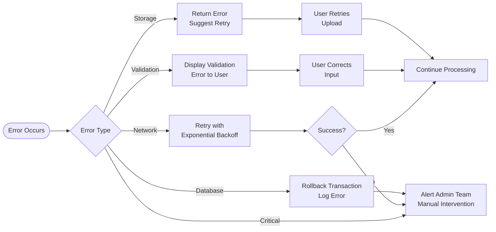

# Hospital Onboarding Process - Flowchart

```mermaid
flowchart TB
    Start([Customer/Sales Initiates Request]) --> CheckSource{Request Source?}
    
    CheckSource -->|Public Form| PublicSubmit[Customer Submits Form<br/>with Captcha]
    CheckSource -->|Sales Manual| SalesCreate[Sales Creates Lead<br/>Directly]
    
    PublicSubmit --> ValidateCaptcha{Captcha Valid?}
    ValidateCaptcha -->|No| RejectSpam[Reject Submission]
    ValidateCaptcha -->|Yes| CreatePending[Create SalesRequest<br/>Status: Pending]
    
    SalesCreate --> CreatePending
    CreatePending --> NotifySales[Email Notification<br/>to Sales Team]
    NotifySales --> WaitClaim[Wait for Sales<br/>to Claim]
    
    WaitClaim --> SalesClaim[Sales User Claims Lead<br/>Set OwnerSalesUserId]
    SalesClaim --> Qualification[Sales Conducts<br/>Discovery Call]
    
    Qualification --> QualifyDecision{Qualified?}
    QualifyDecision -->|No| RejectLead[Status: Rejected<br/>Log Reason]
    QualifyDecision -->|Yes| UpdateQualified[Status: Qualified<br/>Send Profile Form Link]
    
    UpdateQualified --> DataCollection[Customer/Sales Submits:<br/>Hospital Profile<br/>Technical Requirements<br/>Module Selection]
    DataCollection --> UploadDocs[Upload Required Documents<br/>to Storage Service]
    
    UploadDocs --> ValidateDocs{All Required<br/>Docs Uploaded?}
    ValidateDocs -->|No| UploadDocs
    ValidateDocs -->|Yes| UpdateInProgress[Status: InProgress<br/>Notify Admin for Review]
    
    UpdateInProgress --> AdminReview[Admin Reviews Profile<br/>and Documents]
    
    AdminReview --> AdminDecision{Profile Valid?}
    AdminDecision -->|No| RejectProfile[Reject Profile<br/>Notify Sales<br/>Request Corrections]
    AdminDecision -->|Yes| ApproveProfile[Approve Profile<br/>Status: AwaitingPayment]
    
    RejectProfile --> DataCollection
    
    ApproveProfile --> ConfigurePricing[Sales Configures<br/>Subscription & Pricing]
    ConfigurePricing --> CheckDiscount{Discount<br/>> 10%?}
    
    CheckDiscount -->|Yes| ManagerApproval{Manager<br/>Approved?}
    CheckDiscount -->|No| GenerateQuote[Generate Quote<br/>Send to Customer]
    
    ManagerApproval -->|No| ConfigurePricing
    ManagerApproval -->|Yes| GenerateQuote
    
    GenerateQuote --> WaitPayment[Wait for Payment]
    
    WaitPayment --> ProcessPayment{Payment Method?}
    ProcessPayment -->|Online| AutoConfirm[Auto-Confirm via<br/>Gateway Webhook]
    ProcessPayment -->|Manual| ManualConfirm[Sales Confirms<br/>Payment Manually]
    
    AutoConfirm --> PaymentSuccess[Payment Status: Paid<br/>Set PaidAt Timestamp]
    ManualConfirm --> PaymentSuccess
    
    PaymentSuccess --> UpdateProvisioning[Status: Provisioning<br/>Notify Admin]
    
    UpdateProvisioning --> ProvisionTenant[Admin/Master Triggers<br/>Tenant Provisioning]
    
    ProvisionTenant --> CreateTenant[Create Tenant Record<br/>Set Subscription Details]
    CreateTenant --> ConfigureModules[Configure Enabled Modules]
    ConfigureModules --> CreateAdminUser[Create Hospital Admin User<br/>Generate Temp Password]
    CreateAdminUser --> LinkTenant[Link SalesRequest<br/>to Tenant]
    LinkTenant --> UpdateActive[Status: Active<br/>Set ActivatedAt]
    
    UpdateActive --> SendWelcome[Send Welcome Email<br/>with Login Credentials]
    SendWelcome --> FirstLogin[Hospital Admin<br/>First Login]
    
    FirstLogin --> ValidateTenant{Tenant<br/>Isolation OK?}
    ValidateTenant -->|No| ProvisionError[Log Error<br/>Admin Intervention]
    ValidateTenant -->|Yes| AccessGranted[Customer Accesses<br/>Dashboard]
    
    AccessGranted --> MonitorUsage[Monitor Usage<br/>and Compliance]
    
    MonitorUsage --> CheckCompliance{Compliance<br/>Issues?}
    CheckCompliance -->|Non-Payment| SuspendTenant[Status: Suspended<br/>Disable Access]
    CheckCompliance -->|Violation| SuspendTenant
    CheckCompliance -->|OK| ContinueActive[Status: Active]
    
    SuspendTenant --> ResolveIssue{Issue<br/>Resolved?}
    ResolveIssue -->|Yes| Reactivate[Status: Active<br/>Re-enable Access]
    ResolveIssue -->|No| Deactivate[Status: Deactivated<br/>Permanent Closure]
    
    Reactivate --> MonitorUsage
    
    RejectSpam --> End([Process End])
    RejectLead --> End
    ProvisionError --> End
    Deactivate --> End
    
    style Start fill:#90EE90
    style End fill:#FFB6C1
    style RejectSpam fill:#FF6347
    style RejectLead fill:#FF6347
    style RejectProfile fill:#FFA500
    style SuspendTenant fill:#FFA500
    style Deactivate fill:#FF6347
    style AccessGranted fill:#90EE90
    style PaymentSuccess fill:#90EE90
    style UpdateActive fill:#90EE90
```

## Flowchart Legend

| Color | Meaning |
|-------|---------|
| Green | Success/Positive outcomes |
| Red | Rejection/Termination states |
| Orange | Warning/Suspension states |
| Blue (default) | Normal processing steps |

## Decision Points

| Decision | Criteria | Outcomes |
|----------|----------|----------|
| **Request Source** | Public form vs. Sales manual entry | Determines authentication and validation flow |
| **Captcha Valid** | Google reCAPTCHA v3 score | Accept (score > threshold) or Reject spam |
| **Qualified** | Sales assessment | Proceed to data collection or Reject lead |
| **All Required Docs Uploaded** | Document type checklist | Wait for more uploads or Notify admin |
| **Profile Valid** | Admin review | Approve for payment or Request corrections |
| **Discount > 10%** | Pricing configuration | Require manager approval or Proceed to quote |
| **Manager Approved** | Discount authorization | Generate quote or Return to pricing |
| **Payment Method** | Online vs. Manual | Auto-confirm or Manual confirmation |
| **Tenant Isolation OK** | Database validation | Grant access or Escalate to admin |
| **Compliance Issues** | Usage monitoring | Suspend, Deactivate, or Continue active |
| **Issue Resolved** | Suspension review | Reactivate or Permanent deactivation |

## Error Handling Paths

## State Transition Rules

| From Status | To Status | Trigger | Actor | Validation Required |
|-------------|-----------|---------|-------|---------------------|
| N/A | Pending | Form submission or manual creation | Customer/Sales | Captcha (public) |
| Pending | Qualified | Qualification complete | Sales | Discovery call notes |
| Qualified | InProgress | Profile submitted | Customer/Sales | All profile fields |
| InProgress | AwaitingPayment | Profile approved | Admin | All docs uploaded |
| AwaitingPayment | Provisioning | Payment confirmed | Sales/Admin | Payment status = Paid |
| Provisioning | Active | Tenant created | Admin/Master | Tenant ID set |
| Active | Suspended | Compliance issue | Admin/Master | Suspension reason |
| Suspended | Active | Issue resolved | Admin/Master | Resolution notes |
| Suspended | Deactivated | Permanent closure | Master | Deactivation reason |
| Any | Rejected | Validation failed | Sales/Admin/Master | Rejection reason |
