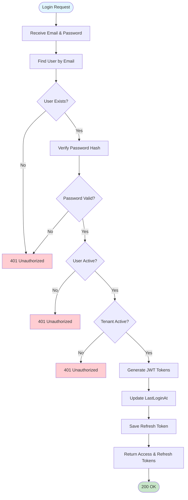
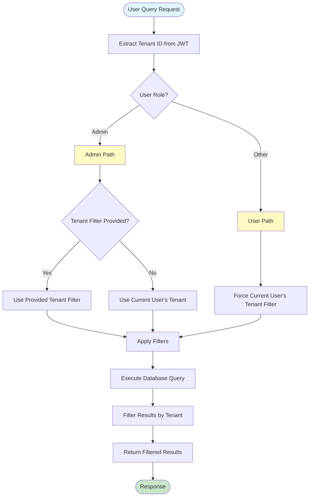

# User Management System - Flowchart

## User Management Operations Flow

```mermaid
flowchart TD
    Start([User Management Request]) --> Auth{Authenticated?}
    Auth -->|No| Unauthorized[401 Unauthorized]
    Auth -->|Yes| ExtractClaims[Extract User ID, Role, Tenant ID from JWT]
    
    ExtractClaims --> CheckEndpoint{Which Endpoint?}
    
    CheckEndpoint -->|GET /me| GetProfile[Get Current User Profile]
    CheckEndpoint -->|GET /| ListUsers[Get User List]
    CheckEndpoint -->|GET /{id}| GetUser[Get User by ID]
    CheckEndpoint -->|POST /| CreateUser[Create New User]
    CheckEndpoint -->|PUT /{id}| UpdateUser[Update User]
    CheckEndpoint -->|DELETE /{id}| DeleteUser[Delete User]
    CheckEndpoint -->|PATCH /{id}/toggle-active| ToggleActive[Toggle Active Status]
    CheckEndpoint -->|POST /change-password| ChangePassword[Change Password]
    CheckEndpoint -->|POST /reset-password| ResetPassword[Reset Password]
    
    GetProfile --> LoadUser1[Load User from Database]
    LoadUser1 --> ReturnProfile[Return User Profile]
    ReturnProfile --> End([200 OK])
    
    ListUsers --> CheckRole1{Is Admin?}
    CheckRole1 -->|No| Forbidden1[403 Forbidden]
    CheckRole1 -->|Yes| BuildQuery[Build Query with Filters]
    BuildQuery --> ApplyFilters[Apply Tenant, Role, Active, Search Filters]
    ApplyFilters --> ApplyPagination[Apply Pagination & Sorting]
    ApplyPagination --> ExecuteQuery[Execute Database Query]
    ExecuteQuery --> ReturnList[Return Paginated User List]
    ReturnList --> End
    
    GetUser --> CheckAccess{Own Profile OR Admin?}
    CheckAccess -->|No| Forbidden2[403 Forbidden]
    CheckAccess -->|Yes| CheckTenant{Same Tenant OR Admin?}
    CheckTenant -->|No| Forbidden3[403 Forbidden]
    CheckTenant -->|Yes| LoadUser2[Load User from Database]
    LoadUser2 --> ReturnUser[Return User Details]
    ReturnUser --> End
    
    CreateUser --> CheckRole2{Is Admin?}
    CheckRole2 -->|No| Forbidden4[403 Forbidden]
    CheckRole2 -->|Yes| ValidateInput[Validate Input Data]
    ValidateInput --> CheckEmail{Email Valid?}
    CheckEmail -->|No| BadRequest1[400 Bad Request]
    CheckEmail -->|Yes| CheckDuplicate{Email Exists in Tenant?}
    CheckDuplicate -->|Yes| BadRequest2[400 Bad Request]
    CheckDuplicate -->|No| CheckTenantValid{Tenant Valid?}
    CheckTenantValid -->|No| BadRequest3[400 Bad Request]
    CheckTenantValid -->|Yes| HashPassword1[Hash Password]
    HashPassword1 --> CreateUserRecord[Create User Record]
    CreateUserRecord --> SaveUser1[Save to Database]
    SaveUser1 --> LogCreate[Log User Creation]
    LogCreate --> ReturnCreated[Return Created User]
    ReturnCreated --> End201([201 Created])
    
    UpdateUser --> LoadUser3[Load User from Database]
    LoadUser3 --> CheckUserExists{User Exists?}
    CheckUserExists -->|No| NotFound1[404 Not Found]
    CheckUserExists -->|Yes| CheckUpdateAccess{Own Profile OR Admin?}
    CheckUpdateAccess -->|No| Forbidden5[403 Forbidden]
    CheckUpdateAccess -->|Yes| CheckRoleChange{Changing Role/Active AND Not Admin?}
    CheckRoleChange -->|Yes| Forbidden6[403 Forbidden]
    CheckRoleChange -->|No| UpdateFields[Update User Fields]
    UpdateFields --> SaveUser2[Save to Database]
    SaveUser2 --> LogUpdate[Log User Update]
    LogUpdate --> ReturnUpdated[Return Updated User]
    ReturnUpdated --> End
    
    DeleteUser --> CheckRole3{Is Admin?}
    CheckRole3 -->|No| Forbidden7[403 Forbidden]
    CheckRole3 -->|Yes| LoadUser4[Load User from Database]
    LoadUser4 --> CheckSelfDelete{Deleting Self?}
    CheckSelfDelete -->|Yes| BadRequest4[400 Bad Request]
    CheckSelfDelete -->|No| SoftDelete[Set IsActive = false]
    SoftDelete --> SaveUser3[Save to Database]
    SaveUser3 --> LogDelete[Log User Deactivation]
    LogDelete --> End204([204 No Content])
    
    ToggleActive --> CheckRole4{Is Admin?}
    CheckRole4 -->|No| Forbidden8[403 Forbidden]
    CheckRole4 -->|Yes| LoadUser5[Load User from Database]
    LoadUser5 --> CheckSelfToggle{Toggling Self?}
    CheckSelfToggle -->|Yes| BadRequest5[400 Bad Request]
    CheckSelfToggle -->|No| ToggleStatus[Toggle IsActive Status]
    ToggleStatus --> SaveUser4[Save to Database]
    SaveUser4 --> LogToggle[Log Status Change]
    LogToggle --> ReturnToggled[Return Updated User]
    ReturnToggled --> End
    
    ChangePassword --> LoadUser6[Load Current User]
    LoadUser6 --> VerifyCurrent{Verify Current Password}
    VerifyCurrent -->|Invalid| BadRequest6[400 Bad Request]
    VerifyCurrent -->|Valid| ValidateNew{New Password Valid?}
    ValidateNew -->|No| BadRequest7[400 Bad Request]
    ValidateNew -->|Yes| HashPassword2[Hash New Password]
    HashPassword2 --> UpdatePassword[Update Password Hash]
    UpdatePassword --> SaveUser5[Save to Database]
    SaveUser5 --> LogPasswordChange[Log Password Change]
    LogPasswordChange --> Success1[200 OK Success]
    Success1 --> End
    
    ResetPassword --> CheckRole5{Is Admin?}
    CheckRole5 -->|No| Forbidden9[403 Forbidden]
    CheckRole5 -->|Yes| LoadUser7[Load User by ID]
    LoadUser7 --> CheckUserExists2{User Exists?}
    CheckUserExists2 -->|No| NotFound2[404 Not Found]
    CheckUserExists2 -->|Yes| ValidateNew2{New Password Valid?}
    ValidateNew2 -->|No| BadRequest8[400 Bad Request]
    ValidateNew2 -->|Yes| HashPassword3[Hash New Password]
    HashPassword3 --> UpdatePassword2[Update Password Hash]
    UpdatePassword2 --> SaveUser6[Save to Database]
    SaveUser6 --> LogPasswordReset[Log Password Reset]
    LogPasswordReset --> Success2[200 OK Success]
    Success2 --> End
    
    style Start fill:#e1f5ff
    style End fill:#c8e6c9
    style End201 fill:#c8e6c9
    style End204 fill:#c8e6c9
    style Unauthorized fill:#ffcdd2
    style Forbidden1 fill:#ffcdd2
    style Forbidden2 fill:#ffcdd2
    style Forbidden3 fill:#ffcdd2
    style Forbidden4 fill:#ffcdd2
    style Forbidden5 fill:#ffcdd2
    style Forbidden6 fill:#ffcdd2
    style Forbidden7 fill:#ffcdd2
    style Forbidden8 fill:#ffcdd2
    style Forbidden9 fill:#ffcdd2
    style BadRequest1 fill:#ffcdd2
    style BadRequest2 fill:#ffcdd2
    style BadRequest3 fill:#ffcdd2
    style BadRequest4 fill:#ffcdd2
    style BadRequest5 fill:#ffcdd2
    style BadRequest6 fill:#ffcdd2
    style BadRequest7 fill:#ffcdd2
    style BadRequest8 fill:#ffcdd2
    style NotFound1 fill:#ffcdd2
    style NotFound2 fill:#ffcdd2
```

## User Authentication Flow



## Multi-Tenant Data Isolation Flow



