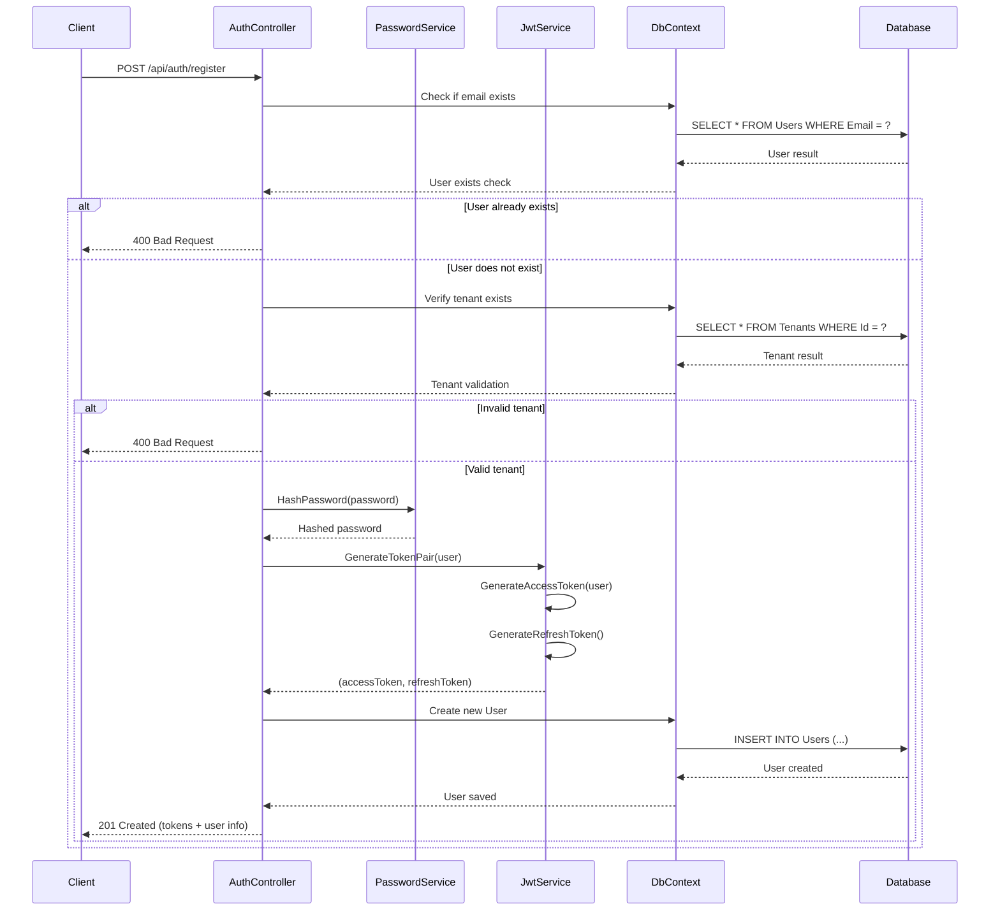
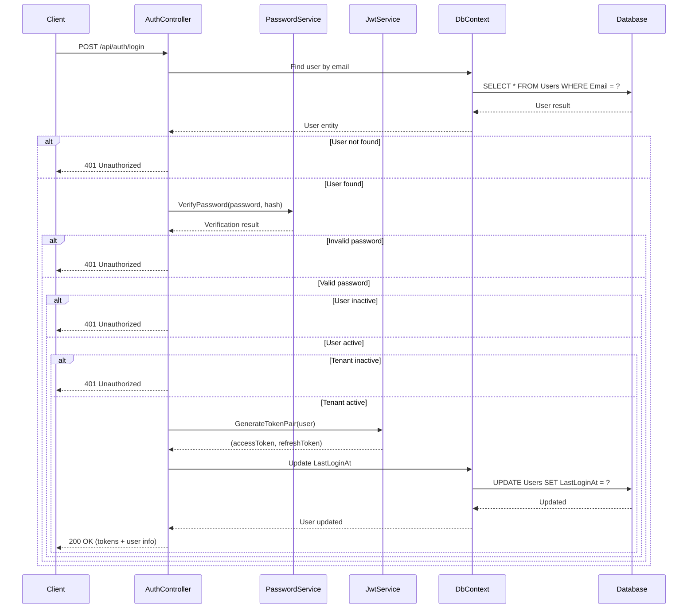
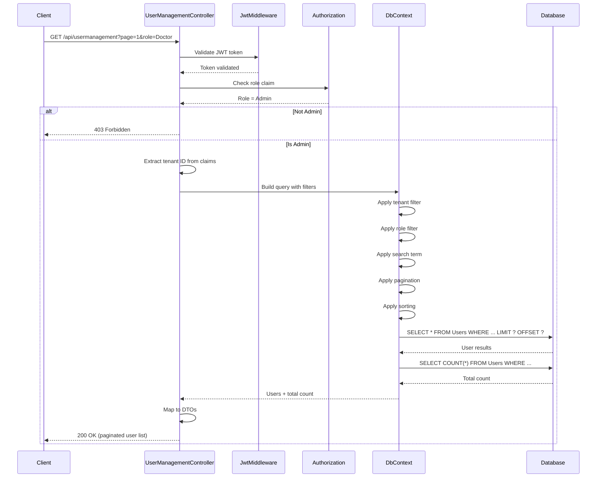
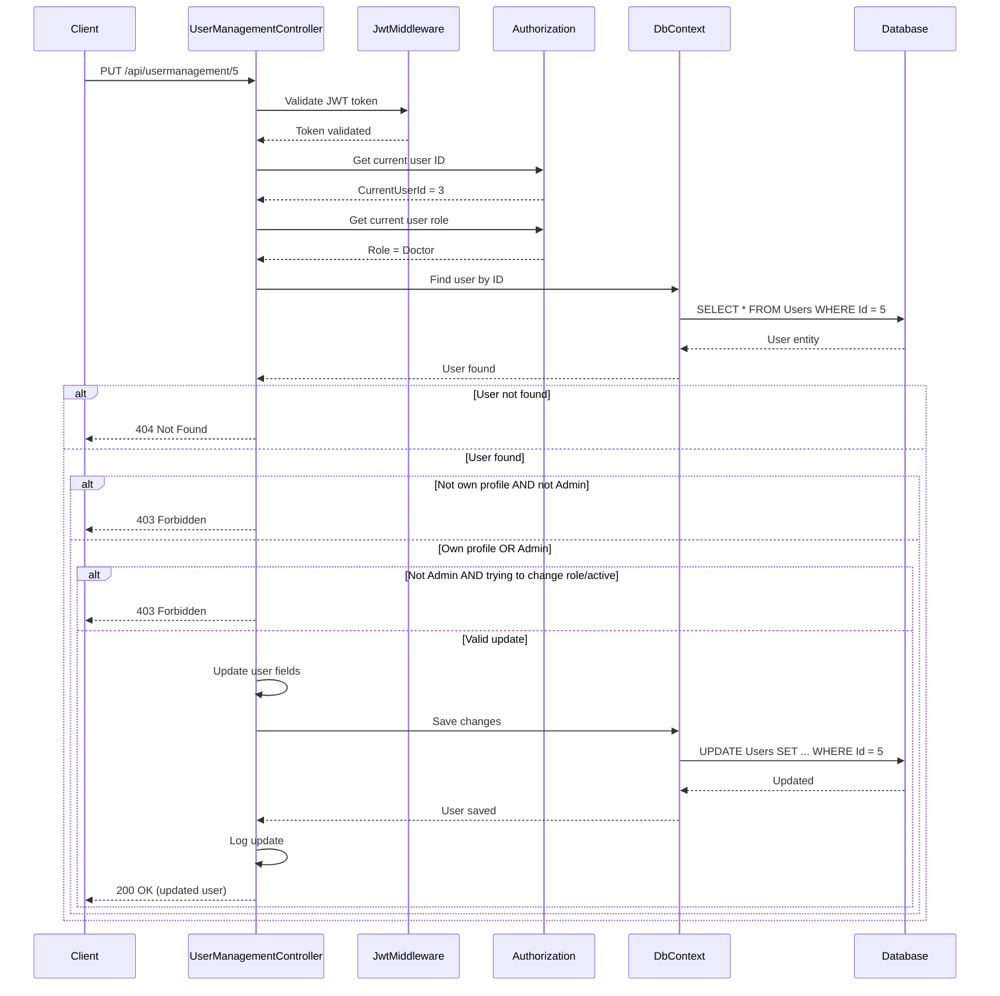
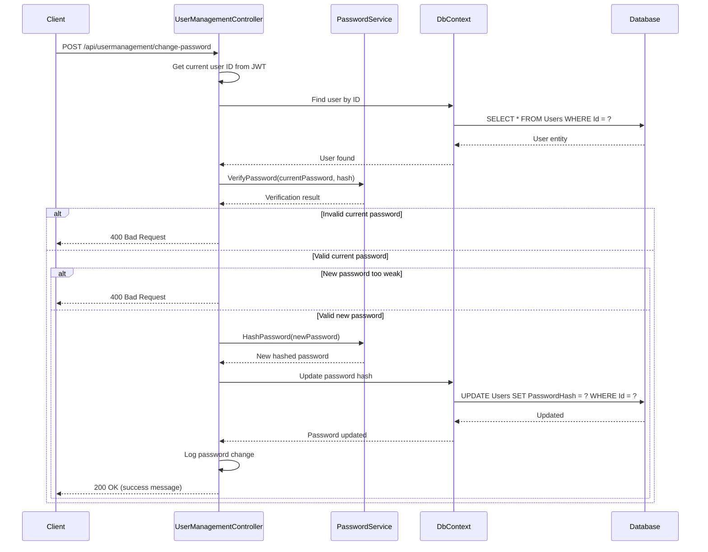

# User Management System - Sequence Diagram

## User Registration Sequence

## User Login Sequence

## Get User List Sequence (Admin)

## Update User Profile Sequence

## Change Password Sequence

