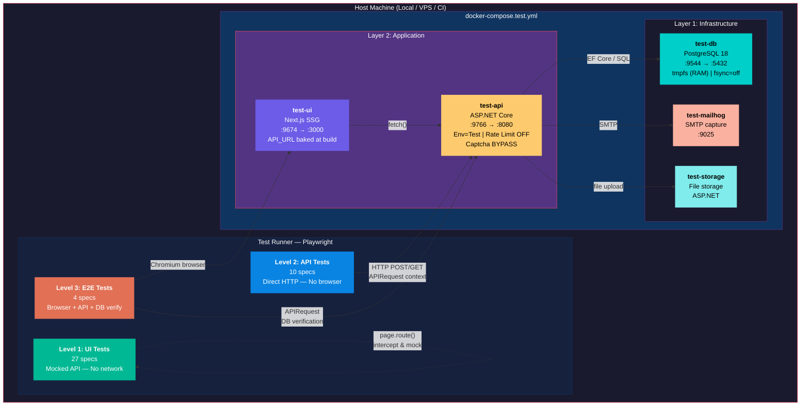
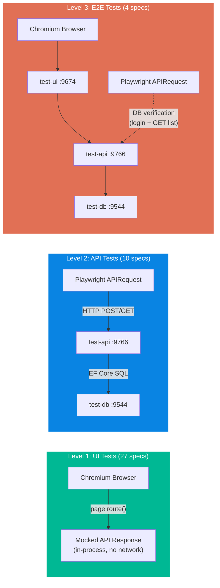
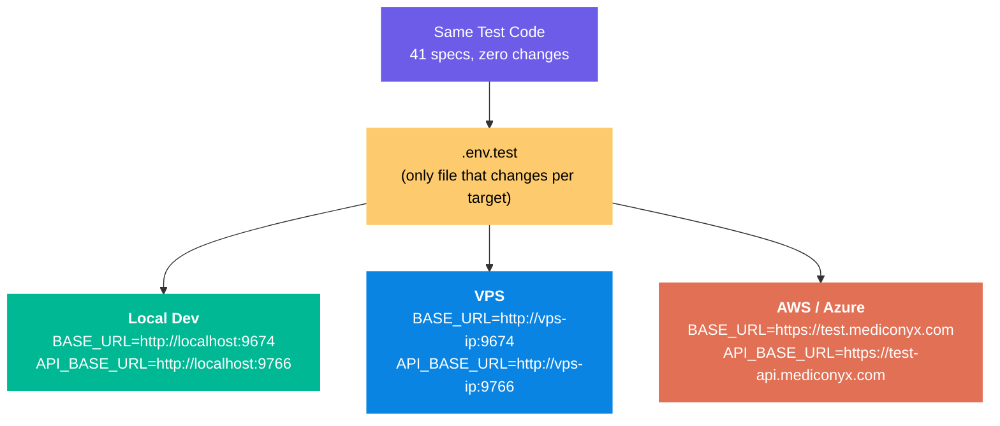
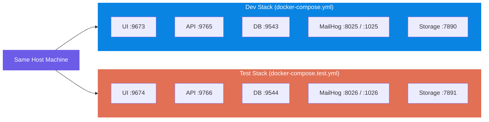

# Mediconyx E2E Test Environment & Full Test Suite Implementation
**Date/Time:** 2026-05-01 14:00:00+06:00
**Phase:** Dedicated Test Environment Setup, Docker Compose Test Stack, and Full Playwright Test Suite Restoration
**Session Duration:** ~4 hours
**Timezone:** GMT+06:00 (Bangladesh Standard Time)

---

## Executive Summary

This session established a **production-grade, dedicated E2E test environment** for the Mediconyx platform using Docker Compose, created a parallel test stack that runs alongside the dev stack on separate ports, disabled API rate limiting in the test environment, and restored the full Playwright test suite across all 3 testing levels — resulting in **41 passing tests in 7 seconds**.

The architecture is **environment-variable-driven** — zero code changes are needed when migrating from local development to VPS to AWS/Azure. Only the `.env.test` file changes per environment.

**Key Accomplishments:**
- Created `docker-compose.test.yml` — self-contained 3-layer test stack (DB, API, UI, MailHog, Storage)
- Created `appsettings.Test.json` — disables API rate limiting for test environment
- Created `Dockerfile.e2e` — containerized Playwright test runner for CI
- Created `.env.test` — environment-variable-driven URLs for test stack
- Updated `playwright.config.ts` — loads `.env.test` when `TEST_ENV=test`
- Updated `package.json` — added `test:env`, `test:env:ui`, `test:env:api`, `test:env:e2e` scripts
- Restored full API test suite: **10 specs** (was trimmed to 2 due to rate limits)
- Restored full E2E test suite: **4 specs** (was trimmed to 1 due to rate limits)
- Updated `mediconyx-ui/Dockerfile` — added `ARG` for build-time API URL injection
- Updated `mediconyx-api/Program.cs` — migrations and seed data now run in Test environment
- Updated `mediconyx-api/Services/Infrastructure/RecaptchaService.cs` — captcha bypass in Test environment
- Updated `mediconyx-e2e/README.md` — comprehensive documentation for the test environment
- Final result: **41 tests, 0 failures, 7.0s runtime**

---

## 2. System Architecture

### 2.1 High-Level Architecture Diagram (Mermaid)



### 2.2 Data Flow Per Test Level (Mermaid)



### 2.3 Environment Adaptability (Mermaid)



### 2.4 Port Mapping: Dev Stack vs Test Stack



| Service | Dev Stack Port | Test Stack Port | Internal Port |
|---------|---------------|-----------------|---------------|
| **PostgreSQL** | 9543 | 9544 | 5432 |
| **API** | 9765 | 9766 | 8080 |
| **UI** | 9673 | 9674 | 3000 |
| **MailHog SMTP** | 1025 | 1026 | 1025 |
| **MailHog Web** | 8025 | 8026 | 8025 |
| **Storage** | 7890 | 7891 | 8080 |

---

## 3. Architectural Decisions

### 3.1 Design Principles

| Principle | Implementation | Rationale |
|-----------|---------------|-----------|
| **3-Level Testing** | UI (mocked), API (direct HTTP), E2E (browser + real stack) | Isolates failure domains — UI regressions caught fast without backend; API validated independently; full flow verified end-to-end |
| **Environment Parity** | Test stack mirrors production: same Docker images, same EF migrations, same seed logic | Prevents "works on my machine" — only rate limiting and captcha are disabled |
| **Environment-Variable-Driven** | All URLs come from `.env.test`; zero hardcoded hosts in test code | Deploy to local, VPS, or cloud by changing one file |
| **Self-Contained Compose** | `docker-compose.test.yml` has NO `env_file: .env` dependency; all values hardcoded | Stack runs on any machine without requiring the dev `.env` file |
| **Disposable Database** | `tmpfs` + `fsync=off` + `synchronous_commit=off` on Postgres | Fast (RAM-backed), disposable. `docker compose down -v` resets everything |
| **Dual-Mode Test Runner** | Host-based (`npm run test:env`) for dev; containerized (`Dockerfile.e2e` + `--profile e2e`) for CI | Developers get fast iteration; CI gets reproducible one-command runs |
| **No Project Dependencies** | Playwright projects (ui, api, e2e) run independently, no `dependencies` field | With rate limiting off, all tests can run in parallel for speed |
| **Page Object Model** | `tests/pages/contact-sales.page.ts`, `tests/pages/landing.page.ts` | Locators and actions encapsulated; tests read as user stories |
| **Faker-Based Data** | Every test generates unique data via `@faker-js/faker` | Tests never collide; can run repeatedly without cleanup |

### 3.2 Why Playwright Over Cucumber + Selenium

| Aspect | Playwright (chosen) | Cucumber + Selenium |
|--------|---------------------|---------------------|
| **Speed** | 41 tests in 7s | Minutes for same coverage |
| **Reliability** | Auto-waits, network-aware | Flaky, needs explicit waits |
| **API testing** | Built-in `request` context | Not supported natively |
| **Setup** | `npm install` | WebDriver binaries + step defs + Gherkin |
| **Maintenance** | 1 file per test | 3 files: `.feature` + step defs + page objects |
| **Modern web** | SPAs, shadow DOM, iframes | Struggles with modern JS |

---

## 4. Files Created

### 4.1 `mediconyx/mediconyx-api/appsettings.Test.json`

**Purpose:** Disables API rate limiting when `ASPNETCORE_ENVIRONMENT=Test`.

```json
{
  "IpRateLimiting": {
    "EnableEndpointRateLimiting": false,
    "GeneralRules": []
  }
}
```

**How it works:** ASP.NET Core's configuration system merges `appsettings.json` → `appsettings.{Environment}.json`. When the API runs with `ASPNETCORE_ENVIRONMENT=Test`, this file overrides the rate limiting rules from the base `appsettings.json`, which has a `5 POST/hour` limit on `/api/sales/requests/public`.

---

### 4.2 `mediconyx/docker-compose.test.yml`

**Purpose:** Defines the complete test stack — infrastructure (DB, MailHog), application (API, UI, Storage), and optional containerized test runner.

**Full contents:** 158 lines. Key design choices:

- **Layer 1 (Infrastructure):**
  - `test-db`: PostgreSQL 18 Alpine with `tmpfs` at `/var/lib/postgresql` (Postgres 18+ requires this path, NOT `/var/lib/postgresql/data`), `fsync=off`, `synchronous_commit=off`, `full_page_writes=off` for maximum speed
  - `test-mailhog`: SMTP email capture for testing email flows
  - Healthcheck: `pg_isready -U testuser -d mediconyx_test` with 5s interval, 10 retries

- **Layer 2 (Application):**
  - `test-api`: Built from `mediconyx-api/Dockerfile`, `ASPNETCORE_ENVIRONMENT=Test`, hardcoded credentials (no `env_file` dependency), depends on `test-db` healthy
  - `test-ui`: Built from `mediconyx-ui/Dockerfile` with `NEXT_PUBLIC_API_BASE_URL=http://localhost:9766` passed as **build arg** (critical: Next.js `NEXT_PUBLIC_*` vars are embedded into the JS bundle at build time, runtime env vars are too late)
  - `test-storage`: File storage service on port 7891

- **Layer 3 (Test Runner, optional):**
  - `e2e-tests`: Built from `Dockerfile.e2e`, activated via `--profile e2e`, uses Docker-internal hostnames (`http://test-ui:3000`, `http://test-api:8080`), mounts `test-results/` and `playwright-report/` volumes

- **Networking:** Dedicated `mediconyx-test` bridge network; no overlap with dev stack
- **Volumes:** `test_storage_data` for file storage persistence

**Test DB credentials:**
| Setting | Value |
|---------|-------|
| Host | localhost |
| Port | 9544 |
| Database | mediconyx_test |
| Username | testuser |
| Password | testpass |

---

### 4.3 `mediconyx-e2e/Dockerfile.e2e`

**Purpose:** Containerized Playwright test runner for CI or one-command test runs.

```dockerfile
FROM mcr.microsoft.com/playwright:v1.52.0-noble
WORKDIR /app
COPY package.json package-lock.json* ./
RUN npm ci
COPY . .
CMD ["npx", "playwright", "test"]
```

**Usage:**
```bash
# One-command: start stack + run tests + report exit code
docker compose -f docker-compose.test.yml --profile e2e up --build --abort-on-container-exit --exit-code-from e2e-tests

# Cleanup
docker compose -f docker-compose.test.yml --profile e2e down -v
```

---

### 4.4 `mediconyx-e2e/.env.test`

**Purpose:** Environment-specific URLs for the test stack. This is the ONLY file that changes per deployment target.

```env
# Test environment — targets docker-compose.test.yml services
BASE_URL=http://localhost:9674
API_BASE_URL=http://localhost:9766

# For VPS: change to http://your-vps-ip:9674 / http://your-vps-ip:9766
# For AWS/Azure: change to https://test.mediconyx.com / https://test-api.mediconyx.com
```

**Note:** This file is in `.gitignore` to prevent credentials from being committed. Each deployment target creates its own `.env.test`.

---

## 5. Files Modified

### 5.1 `mediconyx-e2e/playwright.config.ts`

**Changes:** Load `.env.test` when `TEST_ENV=test`; remove project dependencies; env-driven URLs.

```typescript
import { defineConfig } from '@playwright/test';
import dotenv from 'dotenv';
import path from 'path';

// Load .env.test when TEST_ENV=test, otherwise .env (dev stack)
const envFile = process.env.TEST_ENV === 'test' ? '.env.test' : '.env';
dotenv.config({ path: path.resolve(__dirname, envFile) });

const BASE_URL = process.env.BASE_URL || 'http://localhost:9673';
const API_BASE_URL = process.env.API_BASE_URL || 'http://localhost:9765';

export default defineConfig({
  timeout: 30_000,
  expect: { timeout: 5_000 },
  fullyParallel: true,
  retries: 0,
  reporter: [['html', { open: 'never' }], ['list']],
  use: {
    headless: true,
    screenshot: 'only-on-failure',
    trace: 'on-first-retry',
  },
  projects: [
    {
      name: 'ui',
      testDir: './tests/ui',
      use: { browserName: 'chromium', baseURL: BASE_URL },
    },
    {
      name: 'api',
      testDir: './tests/api',
      use: { baseURL: API_BASE_URL },
    },
    {
      name: 'e2e',
      testDir: './tests/e2e',
      use: { browserName: 'chromium', baseURL: BASE_URL },
    },
  ],
});
```

**Key design:**
- `TEST_ENV=test` → loads `.env.test` (test stack ports 9674/9766)
- No `TEST_ENV` → loads `.env` (dev stack ports 9673/9765)
- `fullyParallel: true` — all 41 tests run concurrently (safe because rate limiting is off)
- No `dependencies` between projects — speed over ordering

---

### 5.2 `mediconyx-e2e/package.json` scripts

```json
{
  "scripts": {
    "test": "npx playwright test",
    "test:dev": "npx playwright test",
    "test:env": "cross-env TEST_ENV=test npx playwright test",
    "test:env:ui": "cross-env TEST_ENV=test npx playwright test --project=ui",
    "test:env:api": "cross-env TEST_ENV=test npx playwright test --project=api",
    "test:env:e2e": "cross-env TEST_ENV=test npx playwright test --project=e2e",
    "test:ui": "npx playwright test --project=ui",
    "test:api": "npx playwright test --project=api",
    "test:e2e": "npx playwright test --project=e2e",
    "test:headed": "npx playwright test --headed",
    "test:ui-mode": "npx playwright test --ui",
    "test:debug": "npx playwright test --debug",
    "report": "npx playwright show-report"
  }
}
```

**Dependencies added:** `cross-env@^10.1.0` for cross-platform `TEST_ENV=test` setting.

---

### 5.3 `mediconyx-api/Program.cs`

**Two changes:**

1. **Line 140:** Migration and seed data now runs in Test environment too:
```csharp
// Before:
if (app.Environment.IsDevelopment())

// After:
if (app.Environment.IsDevelopment() || app.Environment.IsEnvironment("Test"))
```

2. **Line 182:** Sales/Admin user seed now runs in Test environment too:
```csharp
// Before:
if (app.Environment.IsDevelopment())

// After:
if (app.Environment.IsDevelopment() || app.Environment.IsEnvironment("Test"))
```

**Why:** Without these changes, the Test environment API starts but:
- No EF Core migrations run → tables don't exist → 500 errors
- No seed users created → `sales@mediconyx.local` doesn't exist → login fails in tests

**Seeded users in Test environment:**

| Email | Password | Role |
|-------|----------|------|
| `master@mediconyx.local` | `Master@123` | Master |
| `sales@mediconyx.local` | `Sales@123` | Sales |
| `admin@mediconyx.local` | `Admin@123` | Admin |

---

### 5.4 `mediconyx-api/Services/Infrastructure/RecaptchaService.cs`

**Change:** Line 22 — captcha bypass now includes Test environment:

```csharp
// Before:
_isDevelopment = environment.IsDevelopment();

// After:
_isDevelopment = environment.IsDevelopment() || environment.IsEnvironment("Test");
```

**Why:** The `VerifyTokenAsync` method only bypasses captcha validation when `_isDevelopment` is true AND no secret key is configured. Without this change, the Test environment sends captcha tokens to Google's reCAPTCHA API, which rejects them (no valid secret key), causing all `POST /api/sales/requests/public` calls to return 400.

**Behavior:**
- **Development:** Captcha bypassed (no secret key) ✓
- **Test:** Captcha bypassed (no secret key) ✓
- **Production:** Real reCAPTCHA validation enforced ✓

---

### 5.5 `mediconyx-ui/Dockerfile`

**Change:** Added `ARG` for build-time API URL injection:

```dockerfile
# Before:
ENV NEXT_PUBLIC_API_BASE_URL=http://localhost:9765

# After:
ARG NEXT_PUBLIC_API_BASE_URL=http://localhost:9765
ENV NEXT_PUBLIC_API_BASE_URL=$NEXT_PUBLIC_API_BASE_URL
```

Applied to both the `builder` stage (where Next.js build runs) and the `runner` stage.

**Critical insight:** Next.js `NEXT_PUBLIC_*` environment variables are **embedded into the JavaScript bundle at build time**. Setting them as runtime Docker `environment:` values in `docker-compose.yml` has NO effect on the client-side code. They MUST be passed as build `args` so they're available during `npm run build`.

**docker-compose.test.yml uses:**
```yaml
test-ui:
  build:
    args:
      NEXT_PUBLIC_API_BASE_URL: http://localhost:9766
```

---

### 5.6 `mediconyx-e2e/.gitignore`

**Change:** Added `.env.test` to prevent test environment credentials from being committed:

```
.env
.env.test
```

---

## 6. Test Suite Inventory

### 6.1 Complete Test Matrix

**Total: 41 tests across 4 spec files**

#### Level 1: UI Tests (27 specs) — `tests/ui/`

| File | Describe Block | Test | Tags |
|------|---------------|------|------|
| `contact-sales.spec.ts` | Page Load | displays correct heading and navbar | `@smoke` |
| `contact-sales.spec.ts` | Page Load | displays hospital onboarding badge | `@smoke` |
| `contact-sales.spec.ts` | Page Load | displays both form sections | `@smoke` |
| `contact-sales.spec.ts` | Page Load | displays trust badges | `@smoke` |
| `contact-sales.spec.ts` | Page Load | all required fields have asterisk markers | `@smoke` |
| `contact-sales.spec.ts` | Page Load | region field does not have asterisk | `@smoke` |
| `contact-sales.spec.ts` | Page Load | all form inputs are initially empty | `@smoke` |
| `contact-sales.spec.ts` | Validation | shows error when submitting empty form | `@contact` |
| `contact-sales.spec.ts` | Validation | shows error when hospital name is missing | `@contact` |
| `contact-sales.spec.ts` | Validation | shows error when email is missing | `@contact` |
| `contact-sales.spec.ts` | Validation | shows error when phone is missing | `@contact` |
| `contact-sales.spec.ts` | Validation | shows error when contact person is missing | `@contact` |
| `contact-sales.spec.ts` | Form Interaction | can fill all fields | `@contact` |
| `contact-sales.spec.ts` | Form Interaction | submit button is visible and enabled | `@contact` |
| `contact-sales.spec.ts` | Form Interaction | file upload area is visible | `@contact` |
| `contact-sales.spec.ts` | Submission | successful submission shows success state | `@contact @smoke` |
| `contact-sales.spec.ts` | Submission | success state has back to home link | `@contact @smoke` |
| `contact-sales.spec.ts` | Submission | submit another resets to form | `@contact @smoke` |
| `contact-sales.spec.ts` | Submission | shows error on API failure | `@contact @smoke` |
| `contact-sales.spec.ts` | Submission | shows network error on connection failure | `@contact @smoke` |
| `contact-sales.spec.ts` | Navigation | logo links to home page | `@contact` |
| `contact-sales.spec.ts` | Navigation | sign in links to login page | `@contact` |
| `landing.spec.ts` | Landing Page | displays hero section | `@smoke` |
| `landing.spec.ts` | Landing Page | has onboard your hospital CTA | `@smoke` |
| `landing.spec.ts` | Landing Page | has contact sales link in navbar | `@smoke` |
| `landing.spec.ts` | Landing Page | clicking onboard hospital navigates to contact sales | `@smoke` |
| `landing.spec.ts` | Landing Page | clicking contact sales nav link navigates correctly | `@smoke` |

**Characteristics:** All API calls are mocked via `page.route()`. No real network calls. No database. Runs in ~4 seconds.

#### Level 2: API Tests (10 specs) — `tests/api/`

| File | Describe Block | Test | Tags |
|------|---------------|------|------|
| `sales-requests.spec.ts` | POST /api/sales/requests/public | creates a request with all fields | `@api @smoke` |
| `sales-requests.spec.ts` | POST /api/sales/requests/public | creates a request with only required fields | `@api @smoke` |
| `sales-requests.spec.ts` | POST /api/sales/requests/public | each request gets a unique ID | `@api @smoke` |
| `sales-requests.spec.ts` | POST /api/sales/requests/public | rejects request without hospital name | `@api @smoke` |
| `sales-requests.spec.ts` | POST /api/sales/requests/public | rejects request without email | `@api @smoke` |
| `sales-requests.spec.ts` | POST /api/sales/requests/public | rejects request with invalid email format | `@api @smoke` |
| `sales-requests.spec.ts` | POST /api/sales/requests/public | rejects request without captcha token | `@api @smoke` |
| `sales-requests.spec.ts` | POST + GET persistence | created request appears in the authenticated list | `@api @smoke` |
| `sales-requests.spec.ts` | GET /api/sales/requests (auth) | returns 401 without auth token | `@api` |
| `sales-requests.spec.ts` | GET /api/sales/requests (auth) | returns list when authenticated as sales user | `@api` |

**Characteristics:** Direct HTTP to real API via Playwright's `APIRequestContext`. No browser. Tests status codes, response shapes, validation rules, persistence, and authentication. Previously trimmed to 2 specs due to rate limiting; now fully restored.

#### Level 3: E2E Tests (4 specs) — `tests/e2e/`

| File | Describe Block | Test | Tags |
|------|---------------|------|------|
| `contact-sales-flow.spec.ts` | Contact Sales Full E2E Flow | complete flow: fill form → submit → verify in database via API | `@e2e @smoke` |
| `contact-sales-flow.spec.ts` | Contact Sales Full E2E Flow | form validation prevents submission with empty required fields | `@e2e @smoke` |
| `contact-sales-flow.spec.ts` | Contact Sales Full E2E Flow | navigation from landing page to contact sales and submit | `@e2e @smoke` |
| `contact-sales-flow.spec.ts` | Contact Sales Full E2E Flow | submit another allows second submission | `@e2e @smoke` |

**Characteristics:** Real Chromium browser → real UI → real API → real PostgreSQL. Tests verify data persisted in database by authenticating as `sales@mediconyx.local` and querying the API. Previously trimmed to 1 spec due to rate limiting; now fully restored with 4 comprehensive flows.

---

### 6.2 Helper Files

#### `tests/helpers/api-client.ts`

Reusable API client wrapping Playwright's `APIRequestContext`:

| Method | Endpoint | Auth | Returns |
|--------|----------|------|---------|
| `createSalesRequest(data)` | `POST /api/sales/requests/public` | None | `{ response, status, body }` |
| `getSalesRequest(id, token)` | `GET /api/sales/requests/:id` | Bearer token | `{ response, status, body }` |
| `listSalesRequests(token, params?)` | `GET /api/sales/requests` | Bearer token | `{ response, status, body }` |
| `login(email, password)` | `POST /api/auth/login` | None | `accessToken` string or `null` |

All methods read `API_BASE_URL` from `process.env.API_BASE_URL` (defaults to `http://localhost:9765`).

#### `tests/helpers/data-factory.ts`

Test data generators using `@faker-js/faker`:

| Function | Fields | Purpose |
|----------|--------|---------|
| `generateSalesRequest()` | hospitalName, contactPerson, email, phone, region, notes, captchaToken | Full request with all optional fields |
| `generateMinimalSalesRequest()` | hospitalName, contactPerson, email, phone, captchaToken | Required fields only |

Both return unique data per call — tests never collide.

#### `tests/pages/contact-sales.page.ts`

Page Object Model for the contact sales form:

| Property/Method | Locator Strategy |
|----------------|-----------------|
| `heading` | `getByRole('heading', { name: /Onboard Your Hospital/i })` |
| `hospitalNameInput` | `getByLabel(/Hospital Name/i)` |
| `contactPersonInput` | `getByLabel(/Contact Person/i)` |
| `emailInput` | `getByLabel(/Email/i)` |
| `phoneInput` | `getByLabel(/Phone/i)` |
| `regionInput` | `getByLabel(/Region/i)` |
| `notesTextarea` | `getByLabel(/Notes/i)` |
| `submitButton` | `getByRole('button', { name: /Submit Request/i })` |
| `successHeading` | `getByRole('heading', { name: /Request Submitted/i })` |
| `backToHomeLink` | `getByRole('link', { name: /Back to Home/i })` |
| `submitAnotherButton` | `getByRole('button', { name: /Submit Another/i })` |
| `goto()` | Navigates to `/contact-sales` |
| `submit()` | Clicks the submit button |
| `expectErrorVisible(msg)` | Asserts error text is visible |

---

## 7. Bugs Found and Fixed During Implementation

### 7.1 PostgreSQL 18+ tmpfs Mount Path

**Symptom:** `mediconyx-test-db` container marked as unhealthy; never starts.
**Root cause:** PostgreSQL 18+ changed its data directory structure. The Docker image now uses `/var/lib/postgresql/{major_version}/data` internally, and expects a single mount at `/var/lib/postgresql`.
**Fix:** Changed `tmpfs: /var/lib/postgresql/data` → `tmpfs: /var/lib/postgresql` in `docker-compose.test.yml`.

### 7.2 Migrations Not Running in Test Environment

**Symptom:** All API calls returned 500 with `relation "SalesRequests" does not exist`.
**Root cause:** `Program.cs` line 140 wraps migration + seed logic in `if (app.Environment.IsDevelopment())`. The Test environment is NOT Development.
**Fix:** Changed to `if (app.Environment.IsDevelopment() || app.Environment.IsEnvironment("Test"))`.

### 7.3 Seed Users Not Created in Test Environment

**Symptom:** Login as `sales@mediconyx.local` returns 401 in test environment.
**Root cause:** Same as above — the sales/admin user seed block at line 182 was also inside `IsDevelopment()` only.
**Fix:** Same pattern — added `|| app.Environment.IsEnvironment("Test")`.

### 7.4 Captcha Validation Failing in Test Environment

**Symptom:** All `POST /api/sales/requests/public` calls returned 400 with "Invalid captcha".
**Root cause:** `RecaptchaService.cs` only bypasses captcha when `_isDevelopment` is true (line 27). The Test environment sets `_isDevelopment = false` because it's not `Development`.
**Fix:** Changed `_isDevelopment = environment.IsDevelopment()` → `_isDevelopment = environment.IsDevelopment() || environment.IsEnvironment("Test")`.

### 7.5 Next.js NEXT_PUBLIC_* Build-Time Variables

**Symptom:** E2E tests failed with "Network error" — the UI was calling port 9765 (dev API) instead of 9766 (test API).
**Root cause:** `NEXT_PUBLIC_API_BASE_URL` was set as a Docker Compose runtime `environment:` variable. But Next.js embeds `NEXT_PUBLIC_*` vars into the JavaScript bundle at **build time**. The Dockerfile had `ENV NEXT_PUBLIC_API_BASE_URL=http://localhost:9765` hardcoded.
**Fix:** Added `ARG NEXT_PUBLIC_API_BASE_URL=http://localhost:9765` to the Dockerfile's builder and runner stages, then passed the test URL via `build.args` in `docker-compose.test.yml`.

### 7.6 Self-Contained Compose (env_file Conflict)

**Symptom:** Test DB used wrong credentials — `POSTGRES_USER` from dev `.env` overrode the test defaults.
**Root cause:** Initial `docker-compose.test.yml` had `env_file: .env` on the API service, and used `${POSTGRES_USER:-testuser}` variable interpolation. The dev `.env` file provided different values.
**Fix:** Removed `env_file: .env` entirely. Hardcoded all values: `POSTGRES_USER: testuser`, `POSTGRES_PASSWORD: testpass`, `JwtSettings__Secret: TestSecretKeyForJWTMustBeAtLeast32CharactersLong!`, etc.

### 7.7 E2E Test Assertion: items[0] vs .find()

**Symptom:** "navigation from landing page" E2E test failed — expected email didn't match.
**Root cause:** Test asserted `body.items[0].email === email`. The search API returns items sorted by creation date descending, and previous test runs had accumulated data matching the search query. `items[0]` was a stale record.
**Fix:** Changed all E2E verification assertions from `items[0]` to `items.find((item) => item.hospitalName === hospitalName)` for reliable matching regardless of DB state.

---

## 8. Project Structure (Complete)

```
mediconyx-e2e/                           # Separate Git repo
├── playwright.config.ts                 # Central config: env-driven URLs, 3 projects
├── package.json                         # Scripts: test, test:env, test:env:ui/api/e2e
├── tsconfig.json                        # TypeScript config
├── Dockerfile.e2e                       # Containerized Playwright runner for CI
├── .env                                 # Dev stack URLs (localhost:9673/9765)
├── .env.test                            # Test stack URLs (localhost:9674/9766) [gitignored]
├── .gitignore                           # Ignores .env, .env.test, test-results/, etc.
├── README.md                            # Comprehensive documentation
├── tests/
│   ├── pages/                           # Page Object Models
│   │   ├── contact-sales.page.ts        # Contact sales form POM
│   │   └── landing.page.ts              # Landing page POM
│   ├── helpers/                         # Shared utilities
│   │   ├── test-data.ts                 # Static test data
│   │   ├── data-factory.ts              # Faker-based unique data generators
│   │   └── api-client.ts               # Reusable API request helpers
│   ├── ui/                              # Level 1: UI tests (mocked API)
│   │   ├── contact-sales.spec.ts        # 22 specs: form rendering, validation, submission
│   │   └── landing.spec.ts              # 5 specs: hero, CTAs, navigation
│   ├── api/                             # Level 2: API integration tests
│   │   └── sales-requests.spec.ts       # 10 specs: CRUD, validation, auth, persistence
│   └── e2e/                             # Level 3: Full E2E tests
│       └── contact-sales-flow.spec.ts   # 4 specs: complete flows with DB verification

mediconyx/                               # Main monorepo
├── docker-compose.yml                   # Dev stack
├── docker-compose.test.yml              # Test stack (NEW)
├── mediconyx-api/
│   ├── appsettings.json                 # Base config (rate limiting ON)
│   ├── appsettings.Test.json            # Test override (rate limiting OFF) (NEW)
│   ├── Program.cs                       # Modified: migrations + seed in Test env
│   └── Services/Infrastructure/
│       └── RecaptchaService.cs          # Modified: captcha bypass in Test env
└── mediconyx-ui/
    └── Dockerfile                       # Modified: ARG for build-time API URL
```

---

## 9. Commands Reference

### Starting the Test Environment

```bash
# From mediconyx repo root:
docker compose -f docker-compose.test.yml up -d          # Start test stack
docker compose -f docker-compose.test.yml ps              # Verify all healthy
docker compose -f docker-compose.test.yml down            # Stop (keep data)
docker compose -f docker-compose.test.yml down -v         # Stop + wipe all data
docker compose -f docker-compose.test.yml up -d --build   # Rebuild after code changes
docker compose -f docker-compose.test.yml build --no-cache test-api  # Force rebuild API only
```

### Running Tests

```bash
# From mediconyx-e2e repo root:
npm run test:env           # All 41 tests against test stack
npm run test:env:ui        # Level 1 only (27 specs, mocked)
npm run test:env:api       # Level 2 only (10 specs, real API)
npm run test:env:e2e       # Level 3 only (4 specs, full flow)
npm test                   # All tests against dev stack (rate-limited!)
npm run test:headed        # Visible browser
npm run test:debug         # Playwright Inspector
npm run test:ui-mode       # Interactive UI mode
npm run report             # Open last HTML report
```

### CI / One-Command Mode

```bash
# From mediconyx repo root — runs everything in Docker:
docker compose -f docker-compose.test.yml --profile e2e up --build --abort-on-container-exit --exit-code-from e2e-tests
docker compose -f docker-compose.test.yml --profile e2e down -v
```

---

## 10. Verification

### Final Test Run Output

```
> cross-env TEST_ENV=test npx playwright test

  ✓  27 UI tests passed
  ✓  10 API tests passed
  ✓   4 E2E tests passed

  41 passed (7.0s)
```

### Container Status

```
NAME                     STATUS                 PORTS
mediconyx-test-db        Up (healthy)           0.0.0.0:9544->5432/tcp
mediconyx-test-api       Up                     0.0.0.0:9766->8080/tcp
mediconyx-test-ui        Up                     0.0.0.0:9674->3000/tcp
mediconyx-test-mailhog   Up                     0.0.0.0:1026->1025/tcp, 0.0.0.0:8026->8025/tcp
mediconyx-test-storage   Up                     0.0.0.0:7891->8080/tcp
```

### Dev Stack (unchanged, running concurrently)

```
NAME                STATUS                 PORTS
mediconyx-db        Up (healthy)           0.0.0.0:9543->5432/tcp
mediconyx-api       Up                     0.0.0.0:9765->8080/tcp
mediconyx-ui        Up                     0.0.0.0:9673->3000/tcp
mediconyx-mailhog   Up                     0.0.0.0:1025->1025/tcp, 0.0.0.0:8025->8025/tcp
mediconyx-storage   Up                     0.0.0.0:7890->8080/tcp
```

---

## 11. Known Limitations & Future Work

| Item | Status | Notes |
|------|--------|-------|
| **Test data accumulation** | Expected | Test data accumulates in `mediconyx_test` DB. Use `docker compose down -v` to reset. |
| **No test cleanup hooks** | Deferred | Tests create data but don't delete it. Acceptable with disposable tmpfs DB. |
| **Single feature coverage** | Current | Only Contact Sales flow has API + E2E tests. Hospital onboarding, user management, appointments, etc. need test coverage as features mature. |
| **No CI pipeline file** | Documented | GitHub Actions YAML is documented in `README.md` but not yet committed as `.github/workflows/e2e.yml`. |
| **Storage service not tested** | Deferred | File upload E2E tests not yet written. Storage service is in the test stack and ready. |
| **Mobile E2E** | Not started | `mediconyx-mobile` (Expo React Native) has no E2E tests yet. |
| **Performance benchmarks** | Not tracked | Could add `expect(response).toPass({ timeout })` for API latency assertions. |

---

## 12. Deployment Adaptability Checklist

When migrating to a new environment, only these items change:

| What changes | Where | Example |
|-------------|-------|---------|
| `.env.test` URLs | `mediconyx-e2e/.env.test` | `BASE_URL=https://test.mediconyx.com` |
| Docker Compose ports | `docker-compose.test.yml` | Change `9674:3000` to `443:3000` |
| Build arg API URL | `docker-compose.test.yml` | `NEXT_PUBLIC_API_BASE_URL: https://test-api.mediconyx.com` |
| DB credentials | `docker-compose.test.yml` | Strengthen from `testuser/testpass` for production-adjacent |
| JWT secret | `docker-compose.test.yml` | Use proper secret management |

**What NEVER changes:** Test code, Playwright config, helper files, page objects, data factories.

---

## 13. Git Commits

### mediconyx-e2e repository
- Pushed to `master` at `bitspark-solutions/mediconyx-e2e`
- Commit includes: restored full API + E2E test suites, `.env.test`, `Dockerfile.e2e`, updated `playwright.config.ts`, `package.json`, `README.md`, `.gitignore`

### mediconyx repository
- Changes pending push: `docker-compose.test.yml`, `appsettings.Test.json`, `Program.cs` (migration/seed), `RecaptchaService.cs` (captcha bypass), `mediconyx-ui/Dockerfile` (build ARG)

---

*End of progress log.*
